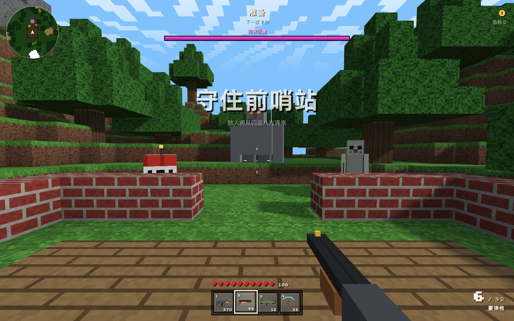
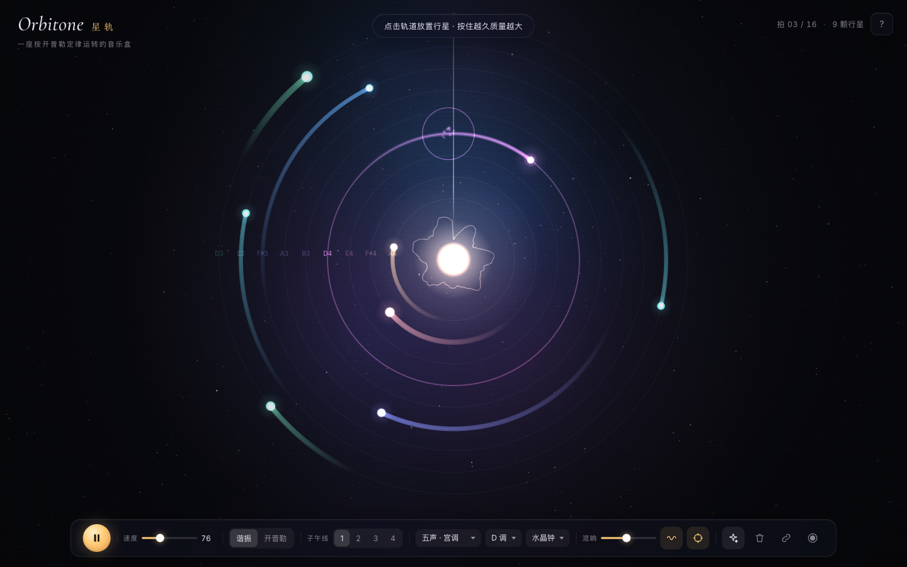
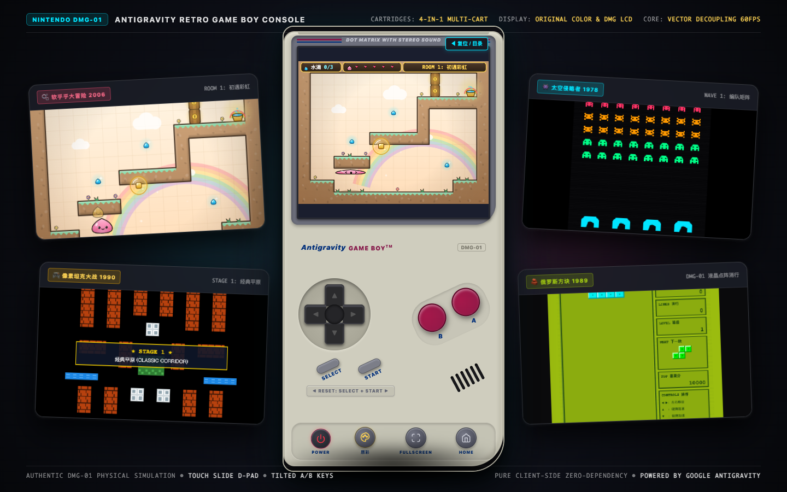

# 模型演练场 · Model Playground

**模型演练场（Model Playground）** 汇集了由前沿大模型端到端编写完成的浏览器原生互动游戏与声学实验项目，零构建依赖，通过 **GitHub Pages** 即点即玩。

- **演练场门户首页**：<https://yuanyang749.github.io/model-playground/>
- **作者 X (Twitter)**：[@Delroy715](https://x.com/Delroy715)（欢迎关注，持续分享前沿大模型实测与作品）

---

## 收录项目一览

| 项目名称 | 创建模型 | 类型 | 在线体验 |
| :--- | :--- | :--- | :--- |
| **VOXEL STRIKE · 方块突击** | `Claude Opus 5.5` | 3D 体素第一人称波次生存射击游戏 | [立即游玩](https://yuanyang749.github.io/model-playground/voxel-strike/) |
| **ORBITONE · 星轨** | `Claude Opus 5.5` | 开普勒行星轨道音乐盒与多音色合成器 | [立即体验](https://yuanyang749.github.io/model-playground/orbitone/) |
| **隔代夺蛋：2026 \| Cyber Eggs** | `Gemini 4 Argon` | 双时空同屏微操街机爽游 | [立即开抢](https://yuanyang749.github.io/model-playground/cyber-eggs/) |
| **RETRO GAME BOY · 掌机模拟器** | `Google Antigravity` | Game Boy (DMG-01) 经典掌机仿真系统与 4 合 1 经典游戏卡带 | [立即开机](https://yuanyang749.github.io/model-playground/retro-gameboy/) |

---

## 1. VOXEL STRIKE · 方块突击 (`./voxel-strike`)
> **创建模型**：`Claude Opus 5.5`



一款基于 **Three.js** 与 **Web Audio API** 从零构建的《我的世界》（Minecraft）风格 3D 第一人称体素波次生存射击游戏。
- **程序化海岛与分块网格**：基于多层分形 Simplex 噪声生成 $96 \times 48 \times 96$ 体素岛屿，采用 $16 \times 16$ 区块剔除隐藏面，并计算 4 级逐顶点环境光遮蔽（Vertex AO）。
- **实时地形破坏与建造**：使用 Amanatides & Woo 体素 DDA 射线检测，支持钻石战镐挖掘采集、右键修筑砖块掩体，以及火箭弹和 TNT 爆破怪造成的球形爆炸弹坑与海水倒灌。
- **4 把 3D 像素武器 + 4 类体素怪物**：包含方块步枪（支持右键 ADS 开镜）、泵动霰弹枪、火箭发射器与钻石战镐；迎战会拆墙的腐尸、闪烁自爆的 TNT 爆破怪、抛物线射箭的骷髅射手与投掷巨石的方块巨像 Boss。

详见 [`voxel-strike/README.md`](./voxel-strike/README.md)。

---

## 2. ORBITONE · 星轨 —— 开普勒行星音乐盒 (`./orbitone`)
> **创建模型**：`Claude Opus 5.5`



一座按 **开普勒第三定律（$T^2 \propto r^3$）** 运转的交互式天体音乐盒与多节奏合成器。
- **双天体运行模式**：支持 **谐振模式**（第 $n$ 条轨道每周期公转整数圈，节奏严丝合缝循环）与 **开普勒模式**（$T^2 \propto r^3$，转速成无理数比，产生永不重复的相位漂移音乐）。
- **直觉式星系交互**：点击轨道放置行星（长按增加行星质量与音量）、拖拽行星切换轨道、切换 1–4 条发声子午线。
- **Web Audio 空间合成器**：内置多种音阶、调式、合成器音色、算法混响、恒星底噪（Drone）、实时录音下载以及 URL Hash 一键分享星系。

详见 [`orbitone/README.md`](./orbitone/README.md)。

---

## 3. 隔代夺蛋：2026 | Cyber Eggs: Generational Rush (`./cyber-eggs`)
> **创建模型**：`Gemini 4 Argon`


> **“质疑大妈，理解大妈，成为大妈 —— 一代人有一代人的鸡蛋要领！”**

一款充满多巴胺波普漫画美学与荒诞现实讽刺的双时空同屏微操街机爽游。左屏是早市排长队抢免费土鸡蛋的**王大妈**，右屏是深夜电脑前蹲点薅“¥0 喜加一”与免费算力的**大孙子**——同一个操作指令同时控制跨越两代人的行为，60 秒无缝串烧“天降甘霖、火眼金睛、零点狂潮、血脉觉醒”四大微操关卡，轰碎【大数据杀熟 BOSS】。

详见 [`cyber-eggs/README.md`](./cyber-eggs/README.md)。

---

## 4. RETRO GAME BOY · 掌机模拟器 (`./retro-gameboy`)
> **创建模型**：`Google Antigravity`



纯前端零依赖驱动的任天堂初代 **Game Boy (DMG-01)** 经典人机工学仿真掌机系统与多游戏运行环境。
- **拟真人机工学机身与物理反馈**：经典灰白工程塑料质感外壳、屏幕边框双色饰线与点阵刻字、滑动触控十字 D-Pad、倾斜深酒红 A/B 键、震动反馈（Haptics）与开机“*ba-ding!*”晶体 Chime 音效。
- **多重液晶调色板实时切换**：支持原彩街机画质（True Color）、经典橄榄绿液晶点阵（DMG）与高对比度 Pocket 黑白三种显示风格，一键无缝热切。
- **内置 4 款经典卡带（4-in-1 Multi-Cart）**：
  1. 🎮 **像素坦克大战 1990 (Battle City)**：经典 FC 坦克对战，独家搭载向量解耦碰撞解死锁物理算法（Vector Decoupling）；
  2. 👾 **太空侵略者 1978 (Space Invaders)**：外星人编队矩阵、4 步步进低音加速曲、掩体像素级弹坑侵蚀物理与高空神秘飞碟；
  3. 🧱 **俄罗斯方块 1989 (Tetris)**：经典七联方块下落、硬降/软降消除与阶段性变速机制；
  4. 🫧 **软乎乎大冒险 2006 (Squishy Buddies)**：5 种果冻史莱姆切换、吐泡泡解谜与双 Boss 战。

详见 [`retro-gameboy/README.md`](./retro-gameboy/README.md)。

---

## 本地运行

```bash
python3 -m http.server 8000
# 浏览器打开 http://localhost:8000
```

