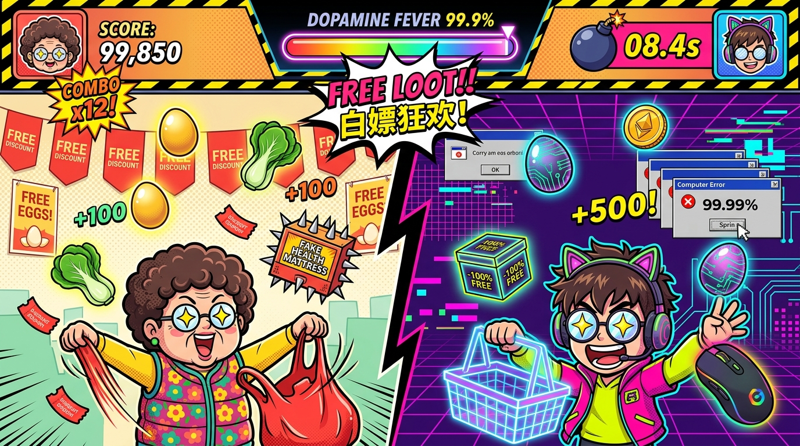

# 隔代夺蛋：2026 | Cyber Eggs: Generational Rush

> **“质疑大妈，理解大妈，成为大妈 —— 一代人有一代人的鸡蛋要领！”**  
> 一款充满多巴胺波普漫画美学与荒诞现实讽刺的双时空同屏微操街机爽游。



---

## 🎮 在线试玩 (GitHub Pages)

👉 **立即开玩**：[https://yuanyang749.github.io/cyber-eggs-2026/](https://yuanyang749.github.io/cyber-eggs-2026/)

*无需安装任何依赖，打开现代浏览器（Chrome / Edge / Safari / Firefox）即可秒开体验。*

---

## 🥚 游戏背景与核心机制

左屏是早市排长队抢免费两斤土鸡蛋的**王大妈**，右屏是深夜电脑前蹲点薅“¥0 喜加一”与免费算力的**大孙子**。  
同一个操作指令同时控制跨越两代人的行为，两边遇到的套路与陷阱居然完全同构！

游戏采用《瓦里奥制造》式的快节奏微操串烧，整局约 60 秒，无缝切换 4 大微操关卡：

| 关卡 | 玩法指令 | 核心微操与博弈点 |
| :--- | :--- | :--- |
| **Stage 1: 天降甘霖** | `左右移动！接住白嫖！` | 方向键 `←/→` 或鼠标拖拽，同时控制祖孙二人接住黄金土鸡蛋、大白菜、赛博蛋与 -100% 礼盒，躲避带刺假保健床垫与弹窗炸弹！ |
| **Stage 2: 火眼金睛** | `看准再点！手撕套路！` | 识别并点击真 `[X]` 撕碎 99.99% 砍一刀与虚假传单弹窗，疯狂点击底层暴露出来的免费鸡蛋大按钮！ |
| **Stage 3: 零点狂潮** | `疯狂连点！冲破99.99%！` | 狂按 `空格键` 或鼠标连点！王大妈大力顶起早市铁皮卷帘门，大孙子化身千手观音用重拳砸碎小数点壁垒！ |
| **Stage 4: 血脉觉醒** | `祖孙合体！暴风吸入！` | 中央闪电分屏线破碎！祖孙合体开启全屏永久 `DOPAMINE FEVER` 磁吸暴风吸入，一拳轰碎【大数据杀熟 BOSS】！ |

---

## ⚡ 视觉与听觉亮点

1. **零外部图片依赖的 Canvas 2D 矢量纸偶**：
   - 粗黑描边新粗野主义（Neo-Brutalism）与高饱和多巴胺波普风格。
   - 角色内置二阶弹簧物理（`Spring`），具备真实的挤压拉伸（Squash & Stretch）与 4 态颜艺状态机（专注、星星眼狂喜、红温触电、觉醒合体）。
2. **Web Audio API 纯代码程序化高燃音效与鼓机**：
   - 16-Step 完整四四拍电子鼓组（Kick / Snare / Hi-Hat）+ 赛博 Sub-Bass + 双振荡器超锯齿波（SuperSaw）洗脑旋律。
   - 阶梯式大调升调连击音、金币三连琶音、激光撕裂与大满贯铜管和弦。
3. **《2026 赛博领蛋多巴胺基因诊断书》**：
   - 游戏结束自动生成病毒式传播诊断书，测定你与王大妈的基因重合度，支持一键导出高清 PNG 海报。

---

## 🛠️ 本地运行开发

由于本项目遵循极简与 KISS 原则，完全采用原生 ES Modules，零第三方重型框架，直接启动本地静态 HTTP 服务器即可：

```bash
# 启动本地服务
python3 -m http.server 8123

# 在浏览器中访问
open http://localhost:8123
```

---

## 📜 许可证

[MIT License](LICENSE) © 2026 yuanyang749
